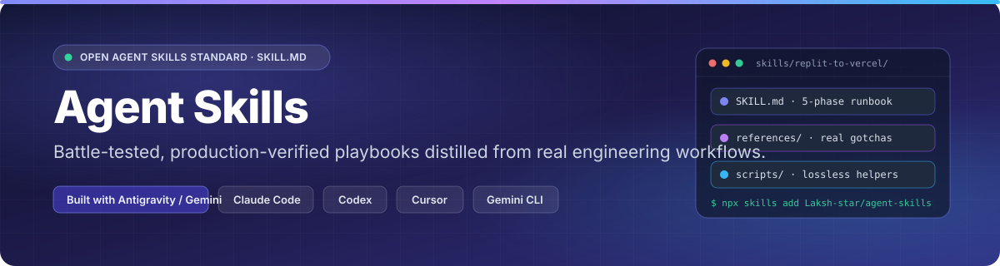
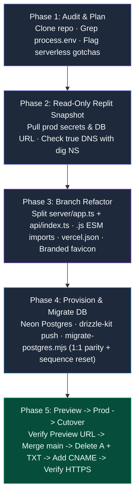

<div align="center">



<p>
  <a href="#skills-catalog"><strong>Skills Catalog</strong></a> &nbsp;·&nbsp;
  <a href="#how-these-skills-are-born"><strong>How These Skills Are Born</strong></a> &nbsp;·&nbsp;
  <a href="#quick-install"><strong>Quick Install</strong></a> &nbsp;·&nbsp;
  <a href="#featured-workflow-replit--vercel"><strong>Featured Workflow</strong></a> &nbsp;·&nbsp;
  <a href="#contributing--philosophy"><strong>Philosophy</strong></a>
</p>

<p>
  
  
  
  
</p>

</div>

---

A growing collection of **reusable, field-tested agent skills** extracted directly from real production engineering work — not synthetic demos.

> **Built with Google Antigravity / Gemini, portable everywhere:** Every skill here is authored in the open `skills/<name>/SKILL.md` Agent Skills format with progressive-disclosure references and executable helper scripts, so it works out of the box in **Antigravity**, **Gemini CLI**, **Claude Code**, **Codex**, and **Cursor**.

---

## Skills Catalog

| Skill | What It Does | Key Assets | Status |
|---|---|---|---|
| **[`replit-to-vercel`](./skills/replit-to-vercel/SKILL.md)** | Zero-downtime migration of full-stack apps (React + Vite + Express + Drizzle + PostgreSQL/Neon) from Replit hosting & IDE to Vercel + Neon + GitHub-driven local/agent dev. | [`SKILL.md`](./skills/replit-to-vercel/SKILL.md) · [`replit-gotchas.md`](./skills/replit-to-vercel/references/replit-gotchas.md) · [`migrate-postgres.mjs`](./skills/replit-to-vercel/scripts/migrate-postgres.mjs) | Production-verified |

*More practitioner skills will be added here as we solve new real-world workflows.*

---

## How These Skills Are Born

Most agent skills fail in the wild because they are written from theory. Every skill in this repo follows a **"Ship First, Distill Second"** loop — captured only *after* completing a real end-to-end production run and hitting (and fixing) the actual edge cases:

```mermaid
flowchart LR
    A["1. Real Production Task<br/>(Live app, live DB, zero downtime)"] --> B["2. Execute End-to-End<br/>(Build, test, deploy, verify)"]
    B --> C["3. Hit Real-World Traps<br/>(Runtime errors, timeouts, DNS quirks)"]
    C --> D["4. Fix & Verify Live<br/>(Preview -> Prod -> Cutover)"]
    D --> E["5. Distill & Sanitize<br/>(Zero secrets, zero private IDs)"]
    E --> F["6. Reusable Skill Package<br/>(SKILL.md + references/ + scripts/)"]

    style A fill:#1e1b4b,stroke:#818cf8,color:#ffffff
    style B fill:#1e293b,stroke:#6366f1,color:#ffffff
    style C fill:#451a03,stroke:#f59e0b,color:#fef3c7
    style D fill:#064e3b,stroke:#10b981,color:#ecfdf5
    style E fill:#1e293b,stroke:#38bdf8,color:#ffffff
    style F fill:#312e81,stroke:#c084fc,color:#ffffff
```



### Example: How `replit-to-vercel` Came Together
During a real migration of a live content + AI Q&A web application (370+ database records, Postgres-backed admin sessions, LLM endpoints, background telemetry, and a custom domain) off Replit onto Vercel + Neon PostgreSQL, we hit **9 concrete traps** that generic migration guides miss:

| Trap Encountered Live | What Broke | Baked Into Skill |
|---|---|---|
| **Node 26 ESM runtime on Vercel** | Build passed, but `/api/*` threw `500 ERR_MODULE_NOT_FOUND` on extensionless relative imports under `"type": "module"` | Explicit `.js` relative imports across `api/` and `server/` |
| **ESM `import` hoisting** | `dotenv.config()` ran *after* `db.ts` threw `DATABASE_URL must be set` locally | Dedicated `server/env.ts` imported first |
| **Neon idle autosuspend (`57P01`)** | Source Neon DB dropped the connection mid-migration during single-row inserts | Snapshot-and-close source first + batched transactional inserts (`migrate-postgres.mjs`) |
| **Serverless killed background work** | Fire-and-forget telemetry promises terminated right after `res.json()` | Wired `@vercel/functions` `waitUntil()` + `attachDatabasePool()` |
| **4.5 MB serverless body cap** | Admin bulk ZIP uploads (>4.5 MB) would hit `413 FUNCTION_PAYLOAD_TOO_LARGE` | Client-side ZIP extraction + chunked JSON batch uploads |
| **Read-only filesystem & macOS dev** | Local CSV backup writes throw `EROFS` on Vercel; `reusePort: true` throws `ENOTSUP` on macOS | Guarded disk writes on `process.env.VERCEL` + removed `reusePort` |
| **Registrar vs. DNS authority** | Hosting panel showed the registrar, while actual NS records lived at another DNS host | Always verify authoritative nameservers via `dig +short NS` first |
| **DNS `CNAME` coexistence rule** | Old `replit-verify=` `TXT` + `A` records blocked adding Vercel's `CNAME` | Explicitly remove both `A` and `replit-verify=` `TXT` before cutover |
| **Leftover platform branding** | Default orange Replit `favicon.png` and bloated asset folders carried over | Replace favicon + exclude non-runtime asset folders in `vercel.json` |

Instead of re-discovering those 9 traps on the next migration (or linking back to a messy chat transcript full of project-specific state), we distilled the entire workflow into **`skills/replit-to-vercel/`** — clean, generic, and ready for any agent to execute on day one.

---

## Featured Workflow: `replit-to-vercel`



> **Zero downtime by design:** Replit is never modified, stopped, or redeployed while you migrate. Every route, database query, AI call, and admin session is verified on a Vercel Preview URL before merging to `main` and switching DNS.

---

## Quick Install

### Option 1: Universal CLI (`skills.sh`)
Install directly into Antigravity, Claude Code, Codex, Cursor, or Gemini CLI:
```bash
npx skills add Laksh-star/agent-skills
```

### Option 2: Google Antigravity / Gemini (Global Install)
```bash
git clone https://github.com/Laksh-star/agent-skills.git ~/agent-skills
mkdir -p ~/.gemini/config/skills
ln -s ~/agent-skills/skills/replit-to-vercel ~/.gemini/config/skills/replit-to-vercel
```

### Option 3: Project-Local (Any Coding Agent)
Copy any skill folder into your repository's `.agents/skills/` (or `.claude/skills/`):
```bash
mkdir -p .agents/skills
cp -R ~/agent-skills/skills/replit-to-vercel .agents/skills/
```

---

## Repository Structure

```text
agent-skills/
├── assets/
│   └── banner.svg                         # Repository header visual
├── skills/
│   └── replit-to-vercel/
│       ├── SKILL.md                       # Concise 5-phase agent runbook
│       ├── references/
│       │   └── replit-gotchas.md          # Detailed failure modes & proven fixes
│       └── scripts/
│           └── migrate-postgres.mjs       # Reusable transactional Postgres migrator
├── LICENSE                                # MIT License
└── README.md
```

---

## Contributing & Philosophy

1. **Progressive disclosure:** Keep `SKILL.md` sharp and scannable; put deep diagnostics in `references/` and repeatable mechanics in `scripts/`.
2. **Real scars only:** Every gotcha listed should correspond to a real failure mode verified against live infrastructure.
3. **Zero secrets, ever:** No personal domains, account IDs, API keys, or client-specific details — only reusable patterns.
4. **Agent-agnostic by default:** Even when authored in Antigravity / Gemini, keep instructions cleanly portable across coding agents.

---

<div align="center">
  <sub>Maintained by <a href="https://github.com/Laksh-star">Lakshmi Narayana U</a> · Practical AI Engineering & Workflows</sub>
</div>
