<div align="center">


<p>
  <a href="#skills-catalog"><strong>Skills Catalog</strong></a> &nbsp;·&nbsp;
  <a href="#how-these-skills-are-born"><strong>How Skills Are Born</strong></a> &nbsp;·&nbsp;
  <a href="#quick-install"><strong>Quick Install</strong></a> &nbsp;·&nbsp;
  <a href="#quality-gate"><strong>Quality Gate</strong></a> &nbsp;·&nbsp;
  <a href="#repository-structure"><strong>Structure</strong></a> &nbsp;·&nbsp;
  <a href="#philosophy"><strong>Philosophy</strong></a>
</p>

<p>
  
  
  
  
</p>

</div>

---

A growing collection of **reusable, field-tested agent skills** extracted directly from real engineering and creative workflows — not synthetic demos.

> **Built in whichever agent did the real work, portable everywhere:** skills here were born in **Antigravity / Gemini**, **Claude Code**, and **Codex** sessions, then distilled into the open `skills/<name>/SKILL.md` Agent Skills format with progressive-disclosure references and executable helper scripts. Every skill passes the same [quality gate](#quality-gate), so it works in **Antigravity**, **Gemini CLI**, **Claude Code**, **Codex**, and **Cursor**.

---

## Skills Catalog

Each skill links to its runbook (`SKILL.md`) and to a field story under [`docs/`](./docs/) with its origin, what was tested, known limits, and when it was last verified.

### Migration & Deployment

| Skill | What It Does | Field Story |
|---|---|---|
| **[`replit-to-vercel`](./skills/replit-to-vercel/SKILL.md)** | Zero-downtime migration of full-stack apps (React + Vite + Express + Drizzle + PostgreSQL/Neon) from Replit to Vercel + Neon + GitHub-driven local/agent dev. | [9 traps + diagram](./docs/replit-to-vercel.md) |
| **[`cloudflare-remote-mcp-worker`](./skills/cloudflare-remote-mcp-worker/SKILL.md)** | Deploys an MCP-capable repo as a Cloudflare Worker with a verified remote `/mcp` endpoint, secrets handed to the user, and docs landed on `main`. | [Origin & limits](./docs/cloudflare-remote-mcp-worker.md) |

### Agent Orchestration & Workflow Apps

| Skill | What It Does | Field Story |
|---|---|---|
| **[`hyperagent-orchestrator`](./skills/hyperagent-orchestrator/SKILL.md)** | Drives Hyperagent agents over its hosted MCP server: dispatch, sequential chains, parallel fan-out, human-in-the-loop refinement, and a fleet dashboard. | [Origin & limits](./docs/hyperagent-orchestrator.md) |
| **[`copilotkit-workflow-ui-builder`](./skills/copilotkit-workflow-ui-builder/SKILL.md)** | Wraps an existing workflow or backend in a CopilotKit UI that reads and operates real app state, with visible approval gates. | [Origin & limits](./docs/copilotkit-workflow-ui-builder.md) |
| **[`content-os-manager`](./skills/content-os-manager/SKILL.md)** | Sets up a markdown Content OS for ideas, drafts, feedback, published posts, and themes, run through a few narrowly scoped agent threads. | [Origin & limits](./docs/content-os-manager.md) |

### Knowledge, Data & Evaluation

| Skill | What It Does | Field Story |
|---|---|---|
| **[`wiki-maintainer`](./skills/wiki-maintainer/SKILL.md)** | Builds and maintains a personal LLM Wiki (Karpathy pattern): compile raw sources into interlinked markdown, lint backlinks, cited Q&A, outputs, and agent exports. | [Origin & limits](./docs/wiki-maintainer.md) |
| **[`mbox-knowledge-pack`](./skills/mbox-knowledge-pack/SKILL.md)** | Turns local `.mbox` exports into private analysis packs, SQLite, wiki compile packets, writing outlines, and opt-in fine-tune prep. | [Origin & limits](./docs/mbox-knowledge-pack.md) |
| **[`expert-judgment-distillation`](./skills/expert-judgment-distillation/SKILL.md)** | Turns domain expert judgment into datasets, eval loops, failure taxonomies, repair sets, rubric models, and case studies. | [Origin & limits](./docs/expert-judgment-distillation.md) |
| **[`sarvam-meeting-minutes`](./skills/sarvam-meeting-minutes/SKILL.md)** | Transcribes Indian-language and code-mixed meetings with Sarvam AI (diarized) and drafts evidence-backed minutes. | [Origin & limits](./docs/sarvam-meeting-minutes.md) |

### Repo & Fork Maintenance

| Skill | What It Does | Field Story |
|---|---|---|
| **[`fork-product-development`](./skills/fork-product-development/SKILL.md)** | Runs an open-source fork as a product: classify changes as fork-only or upstream, keep PR branches clean, avoid branding leaks. | [Origin & limits](./docs/fork-product-development.md) |
| **[`fork-sync-rebase`](./skills/fork-sync-rebase/SKILL.md)** | Reviews upstream drift and safely integrates it into a long-lived fork via dated reference and disposable integration branches. | [Origin & limits](./docs/fork-sync-rebase.md) |
| **[`bumblebee-inventory`](./skills/bumblebee-inventory/SKILL.md)** | Runs Bumblebee supply-chain scans over package metadata and MCP configs, producing raw, public-safe, and agent-ready reports. | [Origin & limits](./docs/bumblebee-inventory.md) |

### Creative & Media

| Skill | What It Does | Field Story |
|---|---|---|
| **[`story-to-animated-film`](./skills/story-to-animated-film/SKILL.md)** | Turns a brief, a PDF, or a video into an original code-drawn animated story film in a style the user picks, with captions and a generated score, plus vertical shorts, language versions, and a prompt pack. No image or video model needed. | [7 traps + diagram](./docs/story-to-animated-film.md) |
| **[`tholu-bommalata-shadow-play`](./skills/tholu-bommalata-shadow-play/SKILL.md)** | Tells a story as a code-drawn shadow-puppet film in the visual language of Tholu Bommalata, opening with the traditional invocation, with a fidelity check against published sources and a written list of departures. | [The question that fixed it](./docs/tholu-bommalata-shadow-play.md) |

### Coming Soon

These are written but held back until their companion repositories are public, so they work from a fresh clone:

- **`competitive-intelligence-agent`** — sample-first and live CocoIndex-backed competitive intelligence through MCP tools.
- **`opencut-producer`** — turns local video into reviewed OpenCut edit candidates with ducking, captions, and human-approved renders.

### Host-Specific Plugins (Maintained Elsewhere)

- **[`codex-capability-profiler`](https://github.com/Laksh-star/codex-skills)** — Codex-only plugin that profiles local Codex capability maturity.
- **[`claude-llm-wiki`](https://github.com/Laksh-star/claude-llm-wiki)** — Claude Code plugin wrapper (`/wiki:*` commands) around `wiki-maintainer`.

---

## How These Skills Are Born

Every skill in this repo follows a **"Ship First, Distill Second"** loop — captured only *after* completing a real end-to-end run and solving the actual edge cases that break in the wild:

```mermaid
flowchart LR
    A["1. Real Task<br/>(Live app, real constraints)"] --> B["2. Execute End-to-End<br/>(Build, deploy, verify)"]
    B --> C["3. Hit Real-World Traps<br/>(Runtime, data, tooling quirks)"]
    C --> D["4. Fix & Verify Live"]
    D --> E["5. Distill & Sanitize<br/>(Zero secrets or private IDs)"]
    E --> F["6. Pass Quality Gate<br/>(validate-skills.py)"]
    F --> G["7. Ship Skill + Story<br/>(skills/ + docs/)"]

    style A fill:#1e1b4b,stroke:#818cf8,color:#ffffff
    style B fill:#1e293b,stroke:#6366f1,color:#ffffff
    style C fill:#451a03,stroke:#f59e0b,color:#fef3c7
    style D fill:#064e3b,stroke:#10b981,color:#ecfdf5
    style E fill:#1e293b,stroke:#38bdf8,color:#ffffff
    style F fill:#3f1d38,stroke:#f472b6,color:#ffffff
    style G fill:#312e81,stroke:#c084fc,color:#ffffff
```



- **`skills/<name>/`** stays lean and token-efficient for coding agents (`SKILL.md`, `references/`, `scripts/`, optional `agents/<host>.yaml` UI metadata).
- **`docs/<name>.md`** holds the human-facing origin story, what was tested, known limits, and the last-verified date — keeping this root README clean as the catalog grows.

---

## Quick Install

### Option 1: Universal CLI (`skills.sh`)
Install into Antigravity, Claude Code, Codex, Cursor, or Gemini CLI:
```bash
npx skills add Laksh-star/agent-skills
```

### Option 2: Google Antigravity / Gemini (Global Install)
```bash
git clone https://github.com/Laksh-star/agent-skills.git ~/agent-skills
mkdir -p ~/.gemini/config/skills
ln -s ~/agent-skills/skills/<skill-name> ~/.gemini/config/skills/<skill-name>
```

### Option 3: Project-Local (Any Coding Agent)
Copy any skill folder into your repository's `.agents/skills/` (or `.claude/skills/`):
```bash
mkdir -p .agents/skills
cp -R ~/agent-skills/skills/<skill-name> .agents/skills/
```

---

## Quality Gate

Every skill must pass [`scripts/validate-skills.py`](./scripts/validate-skills.py) (run locally and in CI, alongside a gitleaks secret scan). It checks spec validity, size, link integrity, script syntax, secrets, personal paths, host-specific coupling, freshness, trigger overlap, file hygiene, and catalog wiring. See [`CONTRIBUTING.md`](./CONTRIBUTING.md) for the full gate and release checklist.

```bash
python3 scripts/validate-skills.py
```

---

## Repository Structure

```text
agent-skills/
├── .github/workflows/validate.yml     # CI: quality gate + gitleaks
├── assets/
│   ├── banner.svg                     # Repository header visual
│   └── *.jpg                          # Stills used in the field stories
├── docs/
│   ├── _template.md                   # Template for new field stories
│   └── <skill-name>.md                # Origin, tests, limits, last verified
├── scripts/
│   └── validate-skills.py             # Quality gate (stdlib only)
├── skills/
│   └── <skill-name>/
│       ├── SKILL.md                   # Concise agent runbook
│       ├── references/                # Deep detail, loaded on demand
│       ├── scripts/                   # Runnable helpers
│       └── agents/                    # Optional host UI metadata (e.g. openai.yaml)
├── CONTRIBUTING.md                    # Quality gate + release checklist
├── LICENSE                            # MIT License
└── README.md
```

---

## Philosophy

1. **Progressive disclosure:** Keep `SKILL.md` sharp and scannable for agents; put deep diagnostics in `references/`, repeatable mechanics in `scripts/`, and human narratives in `docs/`.
2. **Real scars only:** Every gotcha listed corresponds to a real failure mode verified against live infrastructure or a real run.
3. **Zero secrets, ever:** No personal domains, account IDs, API keys, or client-specific details — only reusable patterns.
4. **Agent-agnostic by default:** Whichever agent a skill was born in, its instructions are written for "the agent" and stay portable. Host-specific skills are labeled as such.
5. **Honest freshness:** Every skill states when it was last verified, and against what.

---

<div align="center">
  <sub>Maintained by <a href="https://github.com/Laksh-star">Lakshmi Narayana U</a> · Practical AI Engineering & Workflows</sub>
</div>
