<div align="center">


<p>
  <a href="#skills-catalog"><strong>Skills Catalog</strong></a> &nbsp;·&nbsp;
  <a href="#how-these-skills-are-born"><strong>How Skills Are Born</strong></a> &nbsp;·&nbsp;
  <a href="#quick-install"><strong>Quick Install</strong></a> &nbsp;·&nbsp;
  <a href="#repository-structure"><strong>Structure</strong></a> &nbsp;·&nbsp;
  <a href="#philosophy"><strong>Philosophy</strong></a>
</p>

<p>
  
  
  
  
</p>

</div>

---

A growing collection of **reusable, field-tested agent skills** extracted directly from real production engineering workflows — not synthetic demos.

> **Built with Google Antigravity / Gemini, portable everywhere:** Every skill here is authored in the open `skills/<name>/SKILL.md` Agent Skills format with progressive-disclosure references and executable helper scripts, so it works out of the box in **Antigravity**, **Gemini CLI**, **Claude Code**, **Codex**, and **Cursor**.

---

## Skills Catalog

| Skill | What It Does | Field Story & Workflow | Skill Package |
|---|---|---|---|
| **[`replit-to-vercel`](./skills/replit-to-vercel/SKILL.md)** | Zero-downtime migration of full-stack apps (React + Vite + Express + Drizzle + PostgreSQL/Neon) from Replit to Vercel + Neon + GitHub-driven local/agent dev. | [How we built it (9 traps + diagram)](./docs/replit-to-vercel.md) | [`SKILL.md`](./skills/replit-to-vercel/SKILL.md) · [`replit-gotchas.md`](./skills/replit-to-vercel/references/replit-gotchas.md) · [`migrate-postgres.mjs`](./skills/replit-to-vercel/scripts/migrate-postgres.mjs) |

*New skills are added here as we solve and verify real-world workflows — each with its own field story under [`docs/`](./docs/).*

---

## How These Skills Are Born

Every skill in this repo follows a **"Ship First, Distill Second"** loop — captured only *after* completing a real end-to-end production run and solving the actual edge cases that break in the wild:

```mermaid
flowchart LR
    A["1. Real Production Task<br/>(Live app, real constraints)"] --> B["2. Execute End-to-End<br/>(Build, deploy, verify)"]
    B --> C["3. Hit Real-World Traps<br/>(Runtime, DB, DNS quirks)"]
    C --> D["4. Fix & Verify Live<br/>(Preview -> Production)"]
    D --> E["5. Distill & Sanitize<br/>(Zero secrets or private IDs)"]
    E --> F["6. Ship Skill + Story<br/>(skills/ + docs/)"]

    style A fill:#1e1b4b,stroke:#818cf8,color:#ffffff
    style B fill:#1e293b,stroke:#6366f1,color:#ffffff
    style C fill:#451a03,stroke:#f59e0b,color:#fef3c7
    style D fill:#064e3b,stroke:#10b981,color:#ecfdf5
    style E fill:#1e293b,stroke:#38bdf8,color:#ffffff
    style F fill:#312e81,stroke:#c084fc,color:#ffffff
```



- **`skills/<name>/`** stays lean and token-efficient for coding agents (`SKILL.md`, `references/`, `scripts/`).
- **`docs/<name>.md`** holds the human-facing origin story, workflow diagram, and lessons learned — keeping this root README clean as the catalog grows.

---

## Quick Install

### Option 1: Universal CLI (`skills.sh`)
Install directly into Antigravity, Claude Code, Codex, Cursor, or Gemini CLI:
```bash
npx skills add Laksh-star/agent-skills
```

### Option 2: Google Antigravity / Gemini (Global Install)
```bash
git clone https://github.com/Laksh-star/agent-skills.git ~/agent-skills
mkdir -p ~/.gemini/config/skills
ln -s ~/agent-skills/skills/replit-to-vercel ~/.gemini/config/skills/replit-to-vercel
```

### Option 3: Project-Local (Any Coding Agent)
Copy any skill folder into your repository's `.agents/skills/` (or `.claude/skills/`):
```bash
mkdir -p .agents/skills
cp -R ~/agent-skills/skills/replit-to-vercel .agents/skills/
```

---

## Repository Structure

```text
agent-skills/
├── assets/
│   └── banner.svg                         # Repository header visual
├── docs/
│   └── replit-to-vercel.md                # Per-skill origin stories & workflow diagrams
├── skills/
│   └── replit-to-vercel/
│       ├── SKILL.md                       # Concise agent runbook
│       ├── references/
│       │   └── replit-gotchas.md          # Detailed failure modes & proven fixes
│       └── scripts/
│           └── migrate-postgres.mjs       # Reusable transactional Postgres migrator
├── LICENSE                                # MIT License
└── README.md
```

---

## Philosophy

1. **Progressive disclosure:** Keep `SKILL.md` sharp and scannable for agents; put deep diagnostics in `references/`, repeatable mechanics in `scripts/`, and human narratives in `docs/`.
2. **Real scars only:** Every gotcha listed corresponds to a real failure mode verified against live infrastructure.
3. **Zero secrets, ever:** No personal domains, account IDs, API keys, or client-specific details — only reusable patterns.
4. **Agent-agnostic by default:** Even when authored in Antigravity / Gemini, keep instructions cleanly portable across coding agents.

---

<div align="center">
  <sub>Maintained by <a href="https://github.com/Laksh-star">Lakshmi Narayana U</a> · Practical AI Engineering & Workflows</sub>
</div>
