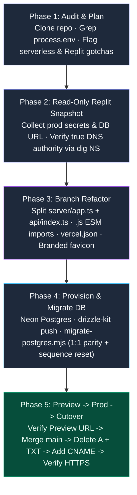

<div align="center">

<p>
  <a href="../README.md"><strong>← Back to Agent Skills</strong></a> &nbsp;·&nbsp;
  <a href="../skills/replit-to-vercel/SKILL.md"><strong>View SKILL.md</strong></a> &nbsp;·&nbsp;
  <a href="../skills/replit-to-vercel/references/replit-gotchas.md"><strong>Gotchas Reference</strong></a> &nbsp;·&nbsp;
  <a href="../skills/replit-to-vercel/scripts/migrate-postgres.mjs"><strong>Migration Script</strong></a>
</p>

# How We Built `replit-to-vercel`

*From a live, zero-downtime production migration to a reusable agent skill.*

</div>

---

## The Real-World Origin

This skill was distilled directly from migrating a live full-stack production web application — **React + Vite + Express + Drizzle ORM + PostgreSQL (Neon)** with 370+ database records, Postgres-backed admin sessions, LLM Q&A endpoints, background telemetry, and a live custom domain — completely off Replit onto **Vercel + Neon PostgreSQL + GitHub-driven local/agent development**, with **zero downtime**.

Rather than keeping the lessons buried in a one-off chat transcript full of project-specific state, we stripped every private detail and encoded the exact sequence, edge-case fixes, and database migration script into a clean skill package that any coding agent can run on day one.

---

## The 5-Phase Zero-Downtime Workflow



> **Zero downtime by design:** The live Replit deployment is never edited, stopped, or redeployed during migration. Every page, API route, AI call, and Postgres-backed admin session is verified on a Vercel Preview URL before merging to `main` and switching DNS.

---

## 9 Real Traps Encountered Live (Now Automated Out)

Every item in [`replit-gotchas.md`](../skills/replit-to-vercel/references/replit-gotchas.md) came from a real failure mode hit or caught during the migration:

| # | Trap Encountered Live | What Broke / Would Break | Baked Into the Skill |
|---|---|---|---|
| 1 | **Node 26 ESM runtime on Vercel** | Build succeeded, but `/api/*` returned `500 ERR_MODULE_NOT_FOUND` on extensionless relative imports under `"type": "module"` | Enforce explicit `.js` relative imports across `api/` and runtime `server/` files |
| 2 | **ESM `import` hoisting** | `dotenv.config()` ran *after* `db.ts` threw `DATABASE_URL must be set` during local dev | Dedicated `server/env.ts` imported as the very first line of `server/index.ts` |
| 3 | **Neon idle autosuspend (`57P01`)** | Source Neon connection dropped mid-migration during single-row remote inserts | Snapshot source DB into memory, close source immediately, then run batched transactional inserts ([`migrate-postgres.mjs`](../skills/replit-to-vercel/scripts/migrate-postgres.mjs)) |
| 4 | **Serverless terminated background work** | Fire-and-forget telemetry promises stopped immediately after `res.json()` | Wrap detached promises in `@vercel/functions` `waitUntil()` and attach `attachDatabasePool()` |
| 5 | **4.5 MB serverless body cap** | Bulk ZIP uploads (>4.5 MB) hit `413 FUNCTION_PAYLOAD_TOO_LARGE` on Vercel | Client-side ZIP extraction (`jszip`) + chunked JSON batch uploads |
| 6 | **Read-only FS & macOS local dev** | Local CSV backup writes throw `EROFS` on Vercel; `reusePort: true` throws `ENOTSUP` on macOS | Guard disk writes on `process.env.VERCEL` and remove `reusePort: true` |
| 7 | **Registrar vs. DNS authority** | Hosting UI showed the domain registrar, while live NS records pointed to another DNS provider | Always verify authoritative nameservers via `dig +short NS` before cutover |
| 8 | **DNS `CNAME` coexistence rule** | Old Replit `A` + `replit-verify=` `TXT` records blocked adding Vercel's `CNAME` | Explicitly delete both `A` and `replit-verify=` `TXT` before creating the `CNAME` |
| 9 | **Leftover platform branding & bloat** | Default orange Replit `favicon.png` and large asset folders carried over | Replace favicon with branded SVG + PNG; exclude non-runtime folders in `vercel.json` |

---

## Use This Skill

See the full executable runbook in [`skills/replit-to-vercel/SKILL.md`](../skills/replit-to-vercel/SKILL.md), or install it from the repo root:

```bash
npx skills add Laksh-star/agent-skills
```
