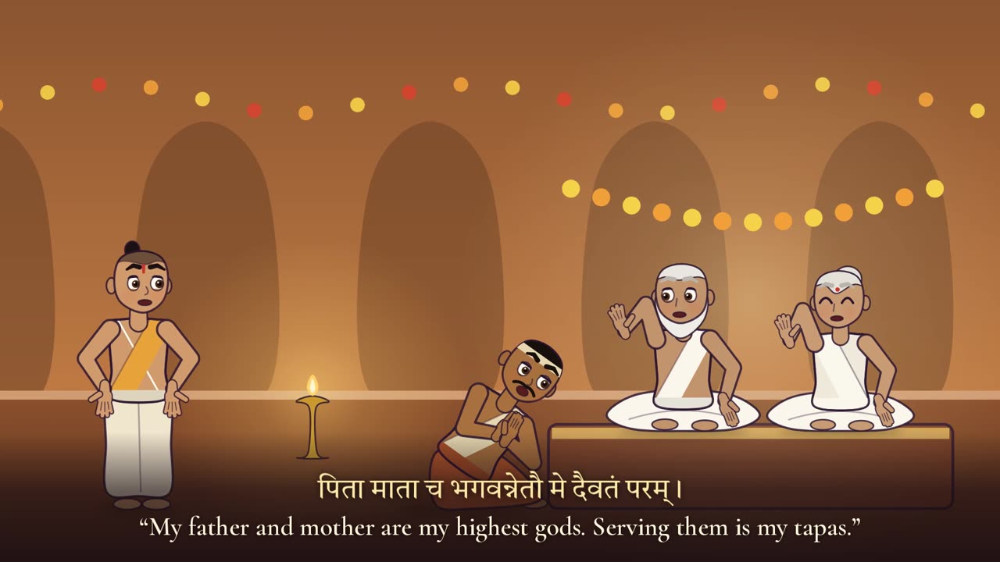
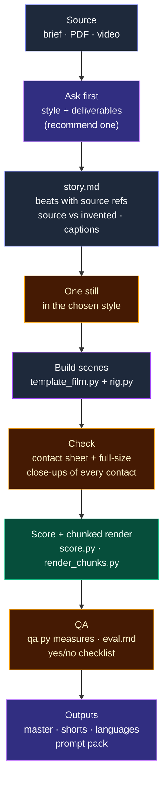

  <a href="../README.md"><strong>← Back to Agent Skills</strong></a> &nbsp;·&nbsp;
  <a href="../skills/story-to-animated-film/SKILL.md"><strong>View SKILL.md</strong></a> &nbsp;·&nbsp;
  <a href="../skills/story-to-animated-film/references/gotchas.md"><strong>Gotchas Reference</strong></a> &nbsp;·&nbsp;
  <a href="../skills/story-to-animated-film/scripts/template_film.py"><strong>Template Film</strong></a>

# How We Built `story-to-animated-film`

*From a 50-page scripture PDF to a family of animated films, drawn entirely in code.*

---

## The Real-World Origin

This skill was distilled from a single working session that started with one attachment: a 52-page PDF of the **Vyādha Gītā**, a teaching story from the Mahābhārata in which a proud young scholar is taught dharma by a housewife and then by a butcher, with Sanskrit verses given only in romanised form.

From that one source the session produced:

- a **2.5-minute storybook film** with captions and a generated score,
- **four vertical shorts** recomposed for 9:16, each with its own title and takeaway card,
- a **Telugu version** of the film and the shorts, with the Sanskrit verses in Telugu script,
- a **picture book**, an **interactive choice game** and a **knowledge graph** of the text,
- and a **shadow-play retelling**, which became its own skill ([`tholu-bommalata-shadow-play`](./tholu-bommalata-shadow-play.md)).

Every frame was drawn in Python with skia and piped to ffmpeg: no image or video model, no paid API. The skill keeps the pipeline, the character rig and the scars, and drops the story.

---

## The Workflow

---

## What Broke, and What the Skill Now Does About It

| Trap | What happened | Built into the skill |
|---|---|---|
| Hand through a head | A father's blessing hand sliced across his son's face. Invisible on the contact sheet. | Full-resolution close-ups of every contact; draw the touching arm last (`skipL`) |
| Background render stopped | A 20-minute render died at frame 1800 of 3840 after the turn ended. | `render_chunks.py`: foreground chunks of ~1300 frames, lossless join |
| Twice-slow renders | Unbounded skia layers cost 0.7 s a frame. | Every layer gets a bounding box: 0.35 s a frame |
| Boxes for ā and ī | The Latin font subset lacked IAST diacritics. | `setup_fonts.py` merges latin + latin-ext |
| Style chosen too late | The look was fixed before the user saw it. | Ask the style first, recommend one, show one still before building |
| Shorts cut feet off | A 9:16 crop of a 16:9 scene lost the ground line. | Recompose per scene with its own camera keys |
| Score drifted 0.6 s | A crossfaded prologue shortened the audio. | Prologue audio padded by the crossfade length |
| Long still stretches | Run on the finished films, a stillness check found a 17 s seated two-shot of dialogue and a 9 s near-frozen hold in one short. Nobody had flagged either. | `qa.py` fails anything still for 4 s outside intended holds; craft rule: a visible change every 2–3 s |
| Peaks over 0 dB | The shadow play's percussion started instantly; AAC turned those clicks into a true peak of −0.3 dBTP. | 4 ms attacks on percussion; the join targets −2 dBTP; `qa.py` checks the delivered file |
| Captions and timings scattered | Captions lived in code, per language, beside the timings they depended on. | `story.md`: one project file for headers, scenes with source refs, and timed captions; `story.py` checks reading speed |

The full list, with symptoms and fixes, is in [`references/gotchas.md`](../skills/story-to-animated-film/references/gotchas.md).

---

## Credits

The QA step, the yes/no eval checklist, the single project file and the numbered craft rules were adapted from ideas in [petergyang/video-explainer](https://github.com/petergyang/video-explainer) (MIT). No code was copied; `qa.py` and `story.py` were written for this pipeline and calibrated on our own films.

---

## Honest Limits

- **The storybook look has a ceiling.** Characters face the front and move with eased poses; it suits explainers and children's tales. For a more polished film, use the prompt pack with an image and video model, and keep the code-drawn film as the animatic.
- **Translations are unproofread.** The skill says so every time and lists the word choices a native reader should check.
- **Music is synthesised.** A drone, a melodic line and percussion generated in numpy; a real recording is always better.

---

## Status

- **Last verified:** 2026-11-26
- **Verified against:** full template render from a fresh copy of the repo, in English and Telugu, including the score and chunked join.
- **Hosts:** agent-agnostic
