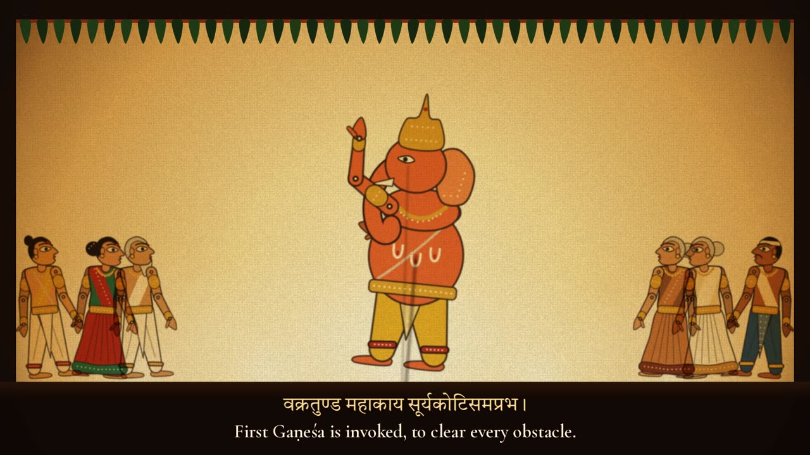

  <a href="../README.md"><strong>← Back to Agent Skills</strong></a> &nbsp;·&nbsp;
  <a href="../skills/tholu-bommalata-shadow-play/SKILL.md"><strong>View SKILL.md</strong></a> &nbsp;·&nbsp;
  <a href="../skills/tholu-bommalata-shadow-play/references/conventions.md"><strong>Conventions & Sources</strong></a> &nbsp;·&nbsp;
  <a href="../skills/tholu-bommalata-shadow-play/scripts/template_shadow.py"><strong>Template Play</strong></a>

# How We Built `tholu-bommalata-shadow-play`

*A code-drawn homage to an endangered puppet theatre, and the question that made it better.*

---

## The Real-World Origin

While turning the Vyādha Gītā into animated films (see [`story-to-animated-film`](./story-to-animated-film.md)), we retold the story as **Tholu Bommalata**, the leather shadow-puppet theatre of the Telugu-speaking region: large, translucent, jewel-coloured puppets in profile, moved on rods behind a lamp-lit cloth.

The first version looked right at a glance. Then came the question that shaped this skill:

> *Tholu bommalata is an ancient tradition, now on the wane. What did you do to make sure your reproduction is true to the form?*

The honest answer was: **nothing beyond general knowledge**. No sources had been read and no photographs of real puppets consulted. A check against published descriptions afterwards found what held up (coloured translucent figures, profile faces, perforation, rods, the cloth screen) and what was missing:

- **The invocation.** A performance opens with the cast pinned at both edges of the screen while Ganesha dances, then Saraswati.
- **The head rod.** The head has its own stick so it can twist quickly.
- **Entrance sides.** Divinities enter from the audience's right and everyone else from the left.
- **The voice.** The puppeteers speak and sing every line; this is the largest gap in any synthetic version.

The second version fixed the first three. The skill now makes that check the **first step**, not an afterthought, and requires a written list of departures with every delivery.

---

## The Workflow

---

## A Note on Respect

This is an homage in the form's visual language, not a reproduction of any maker's puppets, and it cannot replace a troupe. The puppeteer families, concentrated today in Anantapur, Guntur and Nellore districts, are hereditary performers and makers of a tradition that sources describe as endangered. For anything published, the skill recommends crediting the tradition by name and, where possible, commissioning a practising troupe for the voice, the songs and a review.

The Telugu voice-script guide in [`references/voice-script.md`](../skills/tholu-bommalata-shadow-play/references/voice-script.md) is explicit about its limits: troupes perform in Telugu, but the families speak Aare, a Marathi dialect, among themselves, and that inflection has to come from a performer.

---

## Status

- **Last verified:** 2026-11-25
- **Verified against:** full template render from a fresh copy of the repo, in English and Telugu, including the score and chunked join.
- **Hosts:** agent-agnostic
